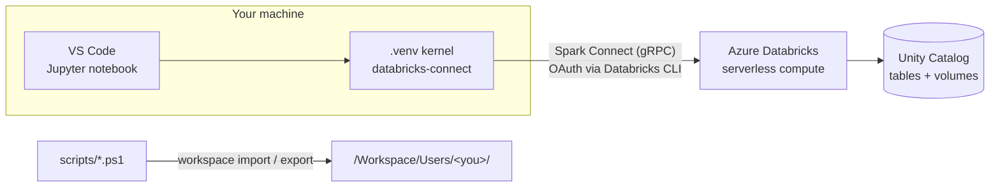

# Databricks Intro

A hands-on PySpark and Databricks learning workspace: 60 Jupyter notebooks that run **from VS Code on your own machine** against an Azure Databricks workspace through [Databricks Connect](https://docs.databricks.com/en/dev-tools/databricks-connect/index.html) and serverless compute. The same notebooks also run unchanged inside the Databricks workspace.

The notebooks go from the first DataFrame to Delta Lake internals, Structured Streaming, slowly changing dimensions and UDFs in Unity Catalog. Each one is self-contained: a short explanation, runnable cells, and links to the official docs.


---

## Contents

- [How it works](#how-it-works)
- [Learning path](#learning-path)
- [Getting started](#getting-started)
- [Syncing with the workspace](#syncing-with-the-workspace)
- [Serverless gotchas](#serverless-gotchas)
- [Repository layout](#repository-layout)
- [Credits](#credits)

---

## How it works



The query plan is built locally and executed on Databricks; only results come back. Every notebook starts with the same bootstrap (also in [`spark_setup.py`](databricks-project/src/spark_setup.py)):

```python
import os, sys
try:
    from databricks.connect import DatabricksSession
    spark = DatabricksSession.builder.getOrCreate()      # local: Databricks Connect
except ImportError:
    if not os.getenv("DATABRICKS_RUNTIME_VERSION"):
        raise RuntimeError("Wrong kernel: select .venv in VS Code")
    from pyspark.sql import SparkSession
    spark = SparkSession.builder.getOrCreate()           # inside a Databricks cluster
```

The guard matters: with plain PySpark on the system Python, a wrong kernel would quietly start a local JVM instead of failing. `spark_setup.display(df, n)` stands in for Databricks' built-in `display()` when running locally.

---

## Learning path

### Core track: `databricks-project/src/`

| Part | # | Notebook |
|---|---|---|
| **Getting started** | 01 | [Introduction to Databricks](databricks-project/src/01%20-%20Introduction%20to%20DataBricks.ipynb) |
| | 02 | [Explore Datasets](databricks-project/src/02%20-%20Explore%20DataSets.ipynb) (Scala; runs in the workspace only) |
| | 03 | [DataFrames](databricks-project/src/03%20-%20DataFrames.ipynb) |
| **Columns and rows** | 04 | [select and selectExpr](databricks-project/src/04%20-%20Select%20and%20SelectExpr.ipynb) |
| | 05 | [Filtering DataFrame Records](databricks-project/src/05%20-%20Filtering%20DataFrame%20Records.ipynb) |
| | 06 | [Filtering and Sorting](databricks-project/src/06%20-%20Filtering%20and%20Sorting.ipynb) |
| | 07 | [DataFrame Transformations](databricks-project/src/07%20-%20DataFrame%20Transformations.ipynb) |
| | 08 | [withColumn and withColumns](databricks-project/src/08%20-%20withColumn%20and%20withColumns.ipynb) |
| | 09 | [Changing Data Types](databricks-project/src/09%20-%20Changing%20Data%20Types.ipynb) |
| | 10 | [Basic Math and Arithmetic Functions](databricks-project/src/10%20-%20Basic%20Math%20and%20Arithmetic%20Functions.ipynb) |
| **Aggregating and reshaping** | 11 | [Grouping and Aggregation](databricks-project/src/11%20-%20Grouping%20and%20Aggregation.ipynb) |
| | 12 | [Grouping and Aggregation (archive)](databricks-project/src/12%20-%20Grouping%20and%20Aggregation%20Archive.ipynb) |
| | 13 | [Pivoting and Unpivoting](databricks-project/src/13%20-%20Pivoting%20and%20Unpivoting.ipynb) |
| | 14 | [Union DataFrames](databricks-project/src/14%20-%20Union%20DataFrames.ipynb) |
| | 15 | [Working with Views](databricks-project/src/15%20-%20Working%20With%20Views.ipynb) |
| **Joins and physical layout** | 16 | [Join Datasets](databricks-project/src/16%20-%20Join%20DataSets.ipynb) |
| | 17 | [Data Join Exercise](databricks-project/src/17%20-%20Data%20Join%20Exercise.ipynb) |
| | 18 | [Broadcast Join Deep Dive](databricks-project/src/18%20-%20Broadcast%20Join%20Deep%20Dive.ipynb) |
| | 19 | [Sort Merge Join Deep Dive](databricks-project/src/19%20-%20Sort%20Merge%20Join%20Deep%20Dive.ipynb) |
| | 20 | [Partitioning and Bucketing Deep Dive](databricks-project/src/20%20-%20Partition%20and%20Bucketing%20Deep%20Dive.ipynb) |
| **Unity Catalog** | 21 | [Catalogs, Schemas and Volumes](databricks-project/src/21%20-%20Working%20With%20Catalogs%2C%20Schemas%20and%20Volumes.ipynb) |
| | 22 | [Managed Tables](databricks-project/src/22%20-%20Managed%20Tables.ipynb) |
| **Delta Lake** | 23 | [Delta Table Introduction](databricks-project/src/23%20-%20Delta%20Table%20Introduction.ipynb) |
| | 24 | [Delta Table Optimization](databricks-project/src/24%20-%20Delta%20Table%20Optimization.ipynb) |
| | 25 | [Updating Records](databricks-project/src/25%20-%20Delta%20Table%20Update%20Records.ipynb) |
| | 26 | [MERGE](databricks-project/src/26%20-%20Delta%20Table%20Merge.ipynb) |
| | 27 | [The Transaction Log](databricks-project/src/27%20-%20Delta%20Transaction%20Log.ipynb) |
| | 28 | [History and Time Travel](databricks-project/src/28%20-%20History%20and%20Time%20Travel.ipynb) |
| | 29 | [Schema Evolution](databricks-project/src/29%20-%20Schema%20Evolution.ipynb) |

### Topic tracks

<details>
<summary><b>Functions</b>: 17 notebooks, from built-ins to UDFs and AI functions (<a href="databricks-project/src/Functions/PLAN.md">roadmap</a>)</summary>

| # | Notebook |
|---|---|
| 01 | [Introduction to Functions](databricks-project/src/Functions/01%20-%20Introduction%20to%20Functions.ipynb) |
| 02 | [String Functions](databricks-project/src/Functions/02%20-%20String%20Functions.ipynb) |
| 03 | [Numeric and Math Functions](databricks-project/src/Functions/03%20-%20Numeric%20and%20Math%20Functions.ipynb) |
| 04 | [Date and Timestamp Functions](databricks-project/src/Functions/04%20-%20Date%20and%20Timestamp%20Functions.ipynb) |
| 05 | [Conditional Functions](databricks-project/src/Functions/05%20-%20Conditional%20Functions.ipynb) |
| 06 | [Collection Functions](databricks-project/src/Functions/06%20-%20Collection%20Functions.ipynb) |
| 07 | [Map and Struct Functions](databricks-project/src/Functions/07%20-%20Map%20and%20Struct%20Functions.ipynb) |
| 08 | [Higher-Order Functions on Arrays](databricks-project/src/Functions/08%20-%20Higher-Order%20Functions%20on%20Arrays.ipynb) |
| 09 | [Window Functions](databricks-project/src/Functions/09%20-%20Window%20Functions.ipynb) |
| 10 | [Aggregation Functions Deep Dive](databricks-project/src/Functions/10%20-%20Aggregation%20Functions%20Deep%20Dive.ipynb) |
| 11 | [Python UDFs](databricks-project/src/Functions/11%20-%20Python%20UDFs.ipynb) |
| 12 | [Pandas UDFs (Vectorized)](databricks-project/src/Functions/12%20-%20Pandas%20UDFs%20%28Vectorized%29.ipynb) |
| 13 | [SQL UDFs in Unity Catalog](databricks-project/src/Functions/13%20-%20SQL%20UDFs%20%28Unity%20Catalog%29.ipynb) |
| 14 | [Python UDFs in Unity Catalog](databricks-project/src/Functions/14%20-%20Python%20UDFs%20in%20Unity%20Catalog.ipynb) |
| 15 | [Performance: Built-in vs UDF vs Pandas UDF](databricks-project/src/Functions/15%20-%20Performance%20Comparison%20Built-in%20vs%20UDF%20vs%20Pandas%20UDF.ipynb) |
| 16 | [Functions in Streaming](databricks-project/src/Functions/16%20-%20Functions%20in%20Streaming.ipynb) |
| 17 | [AI Functions](databricks-project/src/Functions/17%20-%20AI%20Functions.ipynb) |

</details>

<details>
<summary><b>Structured Streaming</b>: 9 notebooks, from Auto Loader to production monitoring</summary>

| # | Notebook |
|---|---|
| 01 | [Introduction to Structured Streaming](databricks-project/src/Streaming/01%20-%20Introduction%20to%20Structured%20Streaming.ipynb) |
| 02 | [Streaming Sources and Auto Loader](databricks-project/src/Streaming/02%20-%20Streaming%20Sources%20and%20Auto%20Loader.ipynb) |
| 03 | [Streaming Transformations](databricks-project/src/Streaming/03%20-%20Streaming%20Transformations.ipynb) |
| 04 | [Windowing and Watermarks](databricks-project/src/Streaming/04%20-%20Windowing%20and%20Watermarks.ipynb) |
| 05 | [Streaming Joins](databricks-project/src/Streaming/05%20-%20Streaming%20Joins.ipynb) |
| 06 | [Output Modes, Triggers and Checkpoints](databricks-project/src/Streaming/06%20-%20Output%20Modes%20Triggers%20and%20Checkpoints.ipynb) |
| 07 | [Streaming with Delta Lake](databricks-project/src/Streaming/07%20-%20Streaming%20with%20Delta%20Lake.ipynb) |
| 08 | [foreachBatch and Custom Sinks](databricks-project/src/Streaming/08%20-%20foreachBatch%20and%20Custom%20Sinks.ipynb) |
| 09 | [Monitoring and Production Patterns](databricks-project/src/Streaming/09%20-%20Monitoring%20and%20Production%20Patterns.ipynb) |

</details>

<details>
<summary><b>Slowly Changing Dimensions</b>: types 1, 2, 3 and 6 with Delta <code>MERGE</code></summary>

| # | Notebook |
|---|---|
| 01 | [SCD Type 2 with Delta Lake](databricks-project/src/SCD/01%20-%20Slowly%20Changed%20Dimension.ipynb) |
| 02 | [SCD Type 1: Overwrite](databricks-project/src/SCD/02%20-%20SCD%20Type%201%20Overwrite.ipynb) |
| 03 | [SCD Type 3: Previous Value](databricks-project/src/SCD/03%20-%20SCD%20Type%203%20Previous%20Value.ipynb) |
| 04 | [SCD Type 6: Hybrid](databricks-project/src/SCD/04%20-%20SCD%20Type%206%20Hybrid.ipynb) |

</details>

<details>
<summary><b>Optimization and Lakeflow Jobs</b></summary>

| Track | Notebook |
|---|---|
| Optimization | [EXPLAIN and Query Plans](databricks-project/src/Optimization/01%20-%20EXPLAIN%20and%20Query%20Plans.ipynb) |
| Lakeflow Jobs | [Introduction to Lakeflow Jobs](databricks-project/src/LakeFlow%20Jobs/01%20-%20Introduction%20to%20LakeFlow%20Jobs.ipynb) |

</details>

---

## Getting started

### Prerequisites

| Need | Notes |
|---|---|
| Azure Databricks workspace with Unity Catalog | Serverless compute enabled. No cluster is needed. |
| Python 3.11+ | The notebooks were written on 3.11. The minor version should match the serverless environment, or UDF and `foreachBatch` cells fail (see [gotchas](#serverless-gotchas)). |
| Databricks CLI | On `PATH`, or the copy bundled with the VS Code Databricks extension; the scripts find either. |
| VS Code | With the Python, Jupyter and Databricks extensions. |
| PowerShell | For the sync scripts in `scripts/`. |

### 1. Create the virtual environment

```powershell
py -3.11 -m venv .venv
.\.venv\Scripts\python.exe -m pip install "databricks-connect" pandas pyarrow
```

Install Databricks Connect into a venv of its own: it ships its own `pyspark` and conflicts with a standalone PySpark install. For serverless, pin `databricks-connect` to the major version of the workspace's [serverless environment](https://docs.databricks.com/en/release-notes/serverless/index.html) and use that environment's Python version.

### 2. Sign in

Add a profile to `~/.databrickscfg` that uses OAuth and serverless compute:

```ini
[<your-profile>]
host                  = https://adb-<workspace-id>.<n>.azuredatabricks.net
auth_type             = databricks-cli
serverless_compute_id = auto
```

Put the same profile name in `$ProfileName` in [`sync/sync.paths.ps1`](sync/sync.paths.ps1), then log in (a browser window opens):

```powershell
powershell -ExecutionPolicy Bypass -File .\scripts\databricks-login.ps1
```

The refresh token lasts about 90 days. When a cell fails with *"refresh token is invalid"*, run the script again and restart the kernel.

### 3. Pick the kernel

Open a notebook in VS Code and choose **Select Kernel → Python Environments → Enter interpreter path**, then point it at `.venv\Scripts\python.exe` (the venv does not always appear in the list). The first cell should print nothing and leave a `spark` session ready.

### 4. Load the sample data

Most notebooks read the countries dataset from a Unity Catalog volume. Create the catalog `population_metrics`, schema `landing` and volume `datasets` (notebook 21 shows the SQL), then upload the folder [`csv_data/`](sync/shared/Section%2008/02%20Uploading%20the%20Countries%20Data%20to%20Landing%20Volume/csv_data) so that the files land here (the `countries_dataset` folder appears twice in the paths the notebooks use):

```
/Volumes/population_metrics/landing/datasets/countries_dataset/countries_dataset/csv_data/
├── countries_population/countries_population.csv
├── countries_population_partitioned/region_id=10/ … region_id=50/
├── country_regions/country_regions.csv
└── country_sub_regions/country_sub_regions.csv
```

The Delta and streaming notebooks write their own tables, demo files and checkpoints under the same volume.

---

## Syncing with the workspace

The local `.ipynb` files are the source of truth. [`sync/sync.paths.ps1`](sync/sync.paths.ps1) maps each local notebook to its path under `/Workspace/Users/<you>/`; add a new notebook there if it should sync.

```powershell
# Workspace -> local
powershell -ExecutionPolicy Bypass -File .\scripts\pull-notebooks.ps1

# Local -> workspace (overwrites the remote copies)
powershell -ExecutionPolicy Bypass -File .\scripts\push-notebooks.ps1

# One folder of the shared course material
.\scripts\pull-shared-subfolder.ps1 -SubPath "Section 08/05 Reading CSV Data into DataFrames"
.\scripts\push-shared-subfolder.ps1 -SubPath "Section 08/05 Reading CSV Data into DataFrames"
```

`.ipynb` files sync in `JUPYTER` format. A `.py` notebook such as `spark_setup.py` syncs as `SOURCE` with `PYTHON` and must start with `# Databricks notebook source`. `databricks.yml` holds a Databricks Asset Bundle target, but the scripts are the main path.

---

## Serverless gotchas

| Symptom | Cause | Fix |
|---|---|---|
| `trigger(processingTime=...)` is rejected | Serverless streaming supports finite triggers only | Use `trigger(availableNow=True)` |
| Checkpoint path errors | Checkpoints must live on a Unity Catalog volume | Write to `/Volumes/...` with a per-run suffix, e.g. `f"..._{uuid.uuid4().hex[:8]}"` |
| `[PYTHON_VERSION_MISMATCH]` on `@udf`, `@pandas_udf` or `foreachBatch` | Local and serverless Python minor versions differ | Match the venv's Python to the serverless environment, or use built-in functions, which run on the server without shipping Python |
| `SparkSession.builder` is blocked | Databricks Connect replaces it | Use `DatabricksSession.builder` (the bootstrap does this) |
| Notebook hangs at the first cell | Wrong kernel; a local JVM is starting | Select `.venv` as the kernel |

---

## Repository layout

```
.
├── databricks-project/
│   └── src/                  # the notebooks: core track 01–29 and topic folders
│       ├── Functions/        #   built-ins, UDFs, AI functions (+ PLAN.md)
│       ├── Streaming/        #   Structured Streaming
│       ├── SCD/              #   slowly changing dimensions
│       ├── Optimization/     #   EXPLAIN and query plans
│       ├── LakeFlow Jobs/    #   orchestration
│       └── spark_setup.py    #   shared bootstrap and local display()
├── scripts/                  # PowerShell: login, push and pull notebooks
├── sync/
│   ├── sync.paths.ps1        # profile name and local ↔ workspace mapping
│   └── shared/               # reference copy of the course's notebooks and data
├── databricks.yml            # Databricks Asset Bundle target (optional path)
├── SYNC.md                   # notes on the sync setup
└── CLAUDE.md                 # notes for AI coding assistants working in this repo
```

---

## Credits

The material under `sync/shared/` comes from the Udemy course **Azure Databricks and Spark SQL (Python)** and is kept here as a reference for the course's sections. The notebooks under `databricks-project/` are my own study notes, written while working through the course and the [Databricks documentation](https://docs.databricks.com/).

**Author:** [Darko Martinović](https://github.com/Darko-Martinovic)
